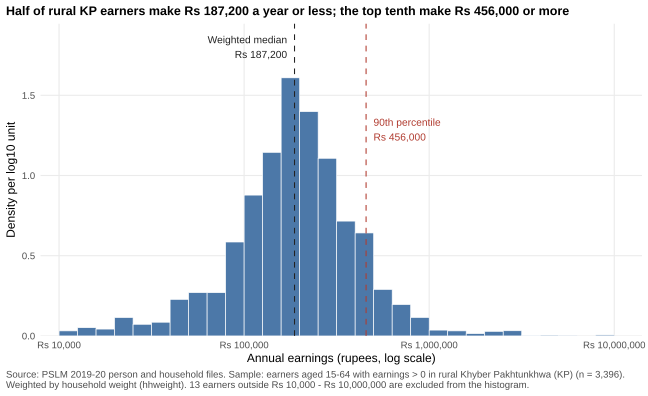
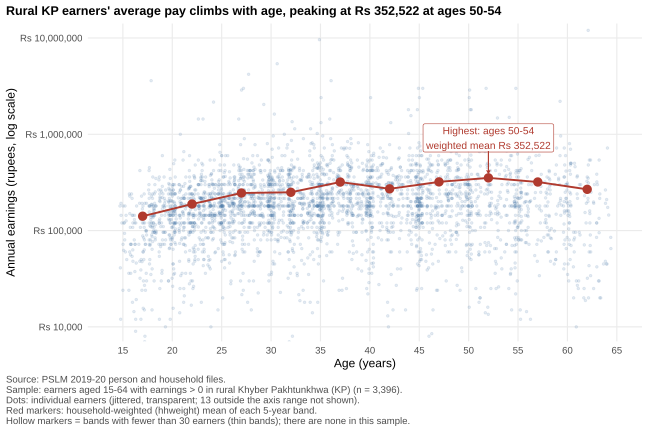
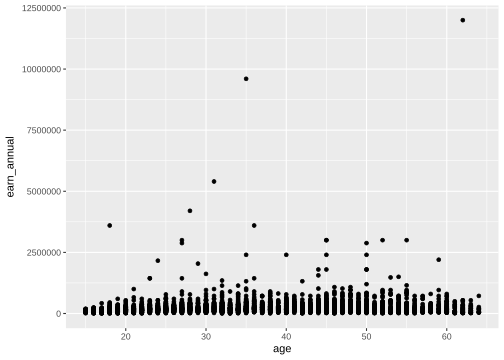
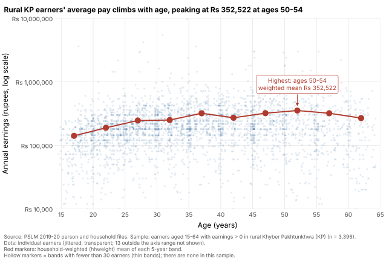

# ECO346 Assignment 1, Fall 2026: Earnings of rural Khyber Pakhtunkhwa's workers

**Student:** Aman Khan, FA24-BEDS-104 (Section A) | **Course:** Data Visualization Techniques for Economists, COMSATS University Islamabad, Lahore Campus

## My variant

Registration number FA24-BEDS-104: the last two digits are 04, and 4 = 0 x 8 + 4, so the remainder is 4 and my
**variant is 4 = KP rural** (`prov_code == 1`, Khyber Pakhtunkhwa, and `urban_rural == 1`, rural).

**Sample:** persons aged 15-64 with `earn_annual > 0` ("earners") in rural KP: **3,396 earners**.
Every statistic is weighted by `hhweight` (attached from the household file by `hhid`).
Weighted quantiles use the assignment's definition (sort, cumulative weight share, smallest x whose share is at least p).

## Figure 1: the distribution of earnings (Q2)



| Statistic | Value |
|---|---|
| Number of earners | 3,396 |
| Weighted median | Rs 187,200 |
| Unweighted median | Rs 180,000 |
| Weighted 10th percentile | Rs 70,000 |
| Weighted 90th percentile | Rs 456,000 |
| 90th / 10th ratio | 6.51 |
| Earners outside Rs 10,000 - Rs 10,000,000 (excluded from the histogram) | 13 |

**What it shows (72 words).** Earnings in rural KP cluster between about Rs 100,000 and Rs 400,000, with a long right tail: the 90th percentile (Rs 456,000) is 6.51 times the 10th (Rs 70,000). The medians differ slightly: weighted Rs 187,200, unweighted Rs 180,000. About 8.4% of earners report exactly Rs 180,000, and 49.5% of weighted earners are at or below it. Household weights, slightly larger for higher earners, tip the 50% mark just above that value.

## Figure 2: earnings and age (Q3, the redesign)



| Age band | Earners | Weighted mean earnings (Rs) |
|---|---:|---:|
| 15-19 | 240 | 141,017 |
| 20-24 | 487 | 188,635 |
| 25-29 | 466 | 245,584 |
| 30-34 | 473 | 249,828 |
| 35-39 | 412 | 319,166 |
| 40-44 | 340 | 271,420 |
| 45-49 | 385 | 320,463 |
| 50-54 | 251 | 352,522 |
| 55-59 | 199 | 319,492 |
| 60-64 | 143 | 268,087 |

No band has fewer than 30 earners, so no marker is hollow. Weighted mean of band 25-29 = **Rs 245,584**; band 45-49 = **Rs 320,463**; the highest weighted mean is in band **50-54** (Rs 352,522).

**Interpretation (83 words).** Average earnings rise steeply from Rs 141,017 in the late teens to about Rs 320,000 by the late thirties, then move sideways, peaking at Rs 352,522 at ages 50-54 before dipping at 60-64: experience raises pay, then older workers scale back. Individual earnings scatter widely around every mean, so age explains only part of pay. The figure cannot tell us whether older workers earn more because they age or because they belong to older cohorts with different schooling; one cross-section compares different people.

I chose transparency 0.15: with 3,396 dots on whole-number ages, a lighter value hides the sparse tails and a darker one turns the centre into a solid block.

## The makeover (Q4)

Default figure (`figures/default.svg`, committed before the redesign): `ggplot(data, aes(x, y)) + geom_point()`.



**Redesign explained (123 words).** First, a log vertical axis: in the default, one earning of Rs 12 million stretches the axis and squashes most earners into a thin strip near zero; on a log scale equal ratios get equal distances, so the bulk becomes readable. Second, transparency and jitter fix overplotting: 3,396 opaque dots on whole-number ages stack into stripes and blobs, while faint jittered dots show where they are dense. Third, weighted band means joined by a line, with the peak annotated directly, give the conditional mean that the default never shows. A finding as title, rupee labels and no grey panel (data-ink) finish the redesign. The default shows the one earner above Rs 10 million; my axis stops there, so the redesign hides that earner.

## Second language (Q5)

`scripts/04_second_language.py` (Python) recomputes the band table (`results/band_table_python.csv`) and redraws the figure (`figures/relationship_python.svg`). It compares itself with the R table: the two tables are identical to the rupee. Band 25-29 mean: **R = 245,584; Python = 245,584.**



**One default that differed (77 words).** matplotlib's defaults differed from ggplot's. Its scatter markers are large (36 pt squared) and fully opaque, so I set s=10 and alpha=0.15 to match the small, faint dots of the R figure. Its log axis also shows minor ticks and 10^n labels, so I fixed major ticks at Rs 10,000 to Rs 10,000,000 and removed minor ticks. matplotlib has no jitter either; I added uniform noise of at most 0.4 years by hand with a fixed seed.

## How to reproduce (fresh clone, no internet)

Needs R with `ggplot2` and `svglite`, and Python 3 with `pandas`, `numpy`, `matplotlib`. From the repository root:

```
Rscript scripts/01_default.R
Rscript scripts/02_distribution.R
Rscript scripts/03_relationship.R
python scripts/04_second_language.py     (on Mac/Linux: python3)
```

| Script | Output |
|---|---|
| `01_default.R` | `figures/default.svg` |
| `02_distribution.R` | `figures/distribution.svg`, `results/q2_numbers.csv`, `results/q2_supporting_facts.csv` |
| `03_relationship.R` | `figures/relationship.svg`, `results/band_table_R.csv`, `results/q4_supporting_facts.csv` |
| `04_second_language.py` | `figures/relationship_python.svg`, `results/band_table_python.csv` |

Slides: `slides/FA24-BEDS-104.pptx`.
